# ⭐ StarWhiteNote | GitHub Release 驱动的电子笔记与思维导图共享站

> **全自动云端同步 · GitHub Releases 即笔记 CMS · 永久 0 元成本 · 纯静态免登录 · 浏览器级 Word/Excel 排版预览 · 思维导图全屏放大**

<p align="center">
  <a href="https://starwhiteisbusy.github.io/StarWhiteNote/"></a>
  <a href="https://github.com/StarWhiteIsBusy/StarWhiteNote"></a>
  <a href="https://github.com/StarWhiteIsBusy/StarWhiteNote/releases"></a>
</p>

---

## 💡 革命性的发布体验：GitHub Releases = 你的笔记系统

**你不再需要手动修改复杂的 JSON 文件，也不需要在电脑上敲任何 Git 命令行！**

**StarWhiteNote** 创新性地将 **GitHub Releases** 作为无头内容管理系统（Headless CMS）：
每当你在 GitHub 上发布一个 Release，网页端就会**全自动实时同步**并生成一篇精美的图文笔记卡片！

### 📋 完美的一对一字段映射

| GitHub Release 发布项 | 网页端展示效果 | 说明与支持特性 |
| :--- | :--- | :--- |
| **Tag version (版本标签)** | **🏷️ 顶部分类标签** | 填 `英语` 即生成 `#英语`；支持逗号分隔多个标签，如 `英语, 考研, 语法` |
| **Release title (发布标题)** | **📌 笔记卡片主标题** | 笔记的显示大标题，如 `第一单元核心词汇与思维导图总结` |
| **Release description (说明正文)** | **📝 笔记详细正文** | 完整支持 Markdown 语法（支持标题、粗体、代码块、列表、引用段落） |
| **Attach binaries (拖拽上传附件)** | **🖼️ 高清画廊 & 📎 关联附件** | **全自动智能分流识别**：<br>• 图片（`.png`, `.jpg`, `.webp`...）自动归类为**多图缩略画廊**，支持点击全屏放大；<br>• 资料文件（`.xmind`, `.docx`, `.xlsx`, `.pdf`, `.excalidraw`...）自动归类为**附件清单**，支持在线排版预览与下载！ |
| **发布时间** | **📅 发布日期** | 自动提取年月日（如 `2026-11-12`） |

---

## 🏛️ 系统架构流程图

```mermaid
flowchart LR
    subgraph A["创作与发布 (GitHub Release)"]
        A1["标签 Tag: 英语, 思维导图"]
        A2["标题 Title: 考研词汇大纲导图"]
        A3["正文: Markdown 复习心得"]
        A4["附件: 拖入 1.png, 词汇.xmind"]
    end

    subgraph B["GitHub 云端服务"]
        B1["GitHub Releases API 开放接口"]
        B2["Amazon S3 / GitHub Fastly 全球节点"]
    end

    subgraph C["StarWhiteNote 纯静态网站"]
        C1["网页自动调用 API 实时同步"]
        C2["动态聚合提取 #英语 #思维导图"]
        C3["生成自适应图片画廊 + 附件列表"]
        C4["内置浏览器级 Word / Excel 排版引擎"]
    end

    A --> B
    B --> C
    C --> D["🌐 访客免登录畅读 / 手机电脑自适应 / 秒级下载"]
```



---

## ✨ 核心特性

- 🔄 **全自动云端同步（零门槛发笔记）**
  - 在手机 GitHub App 或任意电脑网页上发一个 Release，回到网站刷新或点击 **`🔄 同步云端`** 按钮，笔记即可秒级同步呈现！
  - 内置智能 LocalStorage 缓存与离线保护，离线或断网也能秒开阅读。
- 📘 **排版级 Office 预览引擎（免装 Office / WPS）**
  - **Word 文档 (`.docx`)**：浏览器高保真渲染，完整呈现段落缩进、加粗标题、表格与排版，支持 **`⛶ 全屏沉浸阅读`**；
  - **Excel 表格 (`.xlsx` / `.csv`)**：支持多工作表（Sheet Tabs）在线点击切换；
  - **思维导图与工程文件**：原生支持 `.xmind`、`.excalidraw`、`.ora` 等文件一键下载与版本留存。
- 🖼️ **思维导图多图自适应画廊**
  - 多张思维导图切片自动排版为现代化画廊，点击弹出高保真全屏缩放视图，支持右键原图另存。
- 🚀 **GitHub Pages 全球 CDN 加速（默认开启）**
  - 顶部常驻 **`⚡ GitHub Pages 全球加速`** 呼吸绿灯指示，自动路由至全球 Anycast 边缘 CDN 节点，国内访问秒开，告别卡顿。
- 🔍 **毫秒级即时模糊搜索**
  - 输入关键字，即时在笔记标题、内容、分类标签以及关联的文件名中秒级检索。

---

## 🚀 怎样开始发布与同步？（只需 2 步）

### 第 1 步：首次部署网站（只需点一次，全自动完成）

1. 打开本地项目文件夹：  
   `C:\Users\PC\.gemini\antigravity\scratch\notes-file-hub`
2. 双击运行 **`一键发布到GitHub.bat`**：
   - 提示更新说明时按 **Enter 回车**；
   - 弹出 GitHub 登录页面时点击 **【Authorize git-ecosystem】** 授权即可，所有代码自动推送到仓库。
3. 打开 GitHub Pages 设置页面：  
   👉 [https://github.com/StarWhiteIsBusy/StarWhiteNote/settings/pages](https://github.com/StarWhiteIsBusy/StarWhiteNote/settings/pages)
   - **Source** 选择 **Deploy from a branch**；
   - **Branch** 选择 **`main`** 分支，目录选 **`/(root)`**，点击 **Save**。

> **🎉 网站上线成功！专属访问地址：**  
> **`https://starwhiteisbusy.github.io/StarWhiteNote/`**

---

### 第 2 步：日常发布新笔记（在 GitHub Releases 上操作）

以后无论在手机还是电脑上，只要想记笔记、分享思维导图：

1. 打开仓库的 Releases 页面：  
   👉 [https://github.com/StarWhiteIsBusy/StarWhiteNote/releases/new](https://github.com/StarWhiteIsBusy/StarWhiteNote/releases/new)
2. 填写发布信息：
   - **Choose a tag**：输入分类标签（如 `英语` 或 `思维导图, 考研`），点击 **Create new tag**；
   - **Release title**：输入笔记标题（如 `第一单元重点语法梳理`）；
   - **Describe this release**：输入笔记正文，支持写文字、大纲、公式与链接；
   - **Attach binaries**：把你的思维导图大图（`.png`）、`.xmind` 文件、Word 或 PDF 直接拖进虚线框；
3. 点击底部绿色的 **【Publish release】** 保存发布！

**✨ 同步生效**：  
打开你的网站 [https://starwhiteisbusy.github.io/StarWhiteNote/](https://starwhiteisbusy.github.io/StarWhiteNote/)，刚才发布的笔记与附件就会自动呈现在首页上！点击工具栏的 **`🔄 同步云端`** 按钮也能随时强制刷新最新内容！

---

## 📁 仓库目录解析

```text
StarWhiteNote/
├── index.html               # 网站主界面（纯静态 SPA 单页架构，集成 Release 实时同步引擎）
├── style.css                # 现代极简设计系统（Apple / Notion 极简风，全自适应）
├── app.js                   # 核心驱动引擎（自动对接 GitHub Releases API、解析附件与标签、Office预览）
├── notes.json               # 静态笔记备用清单（离线备份与初始示例）
├── files/                   # 本地备用资料目录
│   ├── StarWhiteNote使用指南与功能手册.docx
│   ├── 共享平台架构与操作界面截图.png
│   └── 项目进度与任务清单示例.xlsx
├── docx-preview.min.js      # 浏览器端 Word 排版渲染引擎
├── mammoth.browser.min.js   # Word 文档备用解析库
├── xlsx.full.min.js         # 浏览器端 Excel 高保真表格渲染引擎
├── jszip.min.js             # 客户端解压与流式读取库
├── 一键发布到GitHub.bat     # Windows 本地首次推送与代码更新脚本
├── 一键同步云端最新.bat     # Windows 本地拉取云端变动脚本
├── start.bat                # 本地电脑离线预览调试脚本
├── server.js                # 本地原生零依赖静态服务
└── README.md                # 本说明文档
```

---

## ❓ 常见问题 (FAQ)

<details>
<summary><strong>Q1: 为什么推荐用 GitHub Release 存图片和附件，而不是直接传到代码里？</strong></summary>
<br>
<strong>答：</strong> Git 仓库本身是用来存放代码文本的，如果不断上传高清思维导图、照片或安装包，<code>.git</code> 历史记录会迅速膨胀到几个 GB，导致以后 clone 和 push 极慢甚至触发 GitHub 警告。而 <strong>GitHub Releases 单个文件支持高达 2GB，拥有无限总容量</strong>，享受全球专用 CDN 节点高速下载，且完全不消耗仓库代码体积，是业界最推荐的最佳实践！
</details>

<details>
<summary><strong>Q2: 我发布的 Release 标签可以包含多个分类吗？</strong></summary>
<br>
<strong>答：完全可以！</strong> 在 Release 的 Tag 框中用逗号或空格隔开即可，例如 <code>英语, 考研, 思维导图</code>。网站会自动将其拆分为三个独立标签，并在顶部筛选栏生成对应的 <code>#英语</code>、<code>#考研</code>、<code>#思维导图</code> 胶囊！
</details>

<details>
<summary><strong>Q3: 访客打开我的网站需要登录 GitHub 吗？</strong></summary>
<br>
<strong>答：完全不需要！</strong> 访客以公开只读方式打开网页，无需任何账号密码，即可畅读全文、在线全屏预览 Word / Excel 以及下载思维导图原件。只有您本人能登录 GitHub 账号发布或删除笔记。
</details>

---

## 📄 开源许可证

本项目遵循 [MIT License](LICENSE) 开源协议，供个人知识沉淀、电子笔记整理与思维导图公开分享自由使用。
